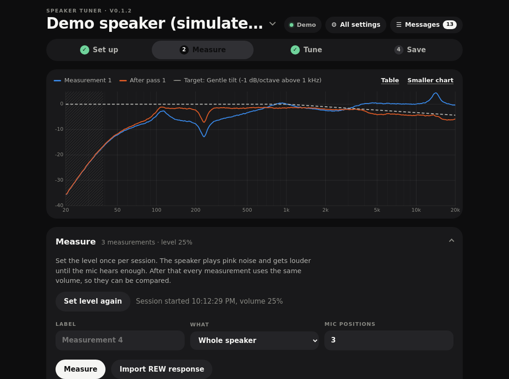

# Speaker Tuner

Measure and tune an ESPHome speaker from Home Assistant, with a microphone.

Speaker Tuner plays pink noise through your speaker, listens with a mic plugged into your
laptop or phone, and shows the frequency response. It then fits EQ filters towards a target
curve, writes them to the speaker live through Home Assistant, measures again to check, and
exports the settings as ESPHome YAML so they stay in your device config.

For two-way speakers it also sets the driver levels, polarity, crossover point, time
alignment, subsonic filter, baffle step and tweeter breakup notch, one guided step at a time.



It is built around the [Sonocotta Louder](https://www.sonocotta.com/) boards with the
[tas58xx crossover fork](https://github.com/craigmillard86/esphome-tas58xx/tree/crossover),
but nothing is tied to them: every speaker-specific detail lives in a **speaker profile**
(a JSON file), so it works with any ESPHome component that exposes its EQ as Home Assistant
entities. Profiles for a generic single-driver PEQ speaker and the tas58xx 15-band graphic EQ
are included.

**Try it without anything:** open the demo (`index.html?demo=1`, see [Running the standalone
page](#running-the-standalone-page)). It runs the whole tool against a simulated two-way
speaker in a simulated room.

---

## Contents

- [What you need](#what-you-need)
- [Install](#install)
- [Prepare the speaker](#prepare-the-speaker)
- [First run](#first-run)
- [Where to put the mic](#where-to-put-the-mic)
- [Measuring](#measuring)
- [Tuning a two-way speaker step by step](#tuning-a-two-way-speaker-step-by-step)
- [Fitting the EQ](#fitting-the-eq)
- [Keeping the result: export and YAML](#keeping-the-result-export-and-yaml)
- [Mics and how much the tool trusts them](#mics-and-how-much-the-tool-trusts-them)
- [Target curves](#target-curves)
- [Running the standalone page](#running-the-standalone-page)
- [Writing a profile for your speaker](#writing-a-profile-for-your-speaker)
- [Where your data is kept](#where-your-data-is-kept)
- [Limits and good to know](#limits-and-good-to-know)
- [Development](#development)

---

## What you need

- **Home Assistant 2024.7 or later, reached over https.** Browsers only let a web page use
  the microphone on `https://` pages (or on `localhost`). If you use Home Assistant Cloud
  (Nabu Casa) or have your own certificate, you are set. Over plain `http://` the tool still
  loads, but the mic will not open, except on the computer HA runs on.
- **An ESPHome speaker** whose EQ settings show up in Home Assistant as `number`, `select`
  and `switch` entities, and a `media_player` entity that can play a file.
- **A microphone.** A measurement mic such as the miniDSP UMIK-1 with its calibration file is
  best. An AV receiver's setup mic or an AKG CK32 works. A phone or laptop mic works too, with
  the tool deliberately careful about what it changes (see [Mics](#mics-and-how-much-the-tool-trusts-them)).
  USB mics work on Android phones with a USB-C adapter.
- **HACS**, to install it the easy way. Not required.

## Install

### With HACS

1. In Home Assistant open **HACS**, the three-dot menu, **Custom repositories**.
2. Add `https://github.com/craigmillard86/sendspin-speaker-cal` with type **Integration**.
3. Find **Speaker Tuner** in HACS and download it.
4. Restart Home Assistant.
5. Go to **Settings > Devices & services > Add integration** and pick **Speaker Tuner**.
   There is nothing to fill in.

A **Speaker Tuner** item appears in the sidebar for admin users.

### By hand

Copy the `custom_components/speaker_tuner` folder from this repository into the
`custom_components` folder of your Home Assistant config (create it if it is missing),
restart Home Assistant, then add the integration as in step 5.

If the config folder is mounted on your computer (for example through the Samba add-on):

```sh
npm run deploy:ha -- /path/to/homeassistant/config
```

### The Home Assistant phone app

The sidebar panel opens in the Home Assistant Companion app too, but whether the app lets a
panel use the microphone depends on the app version and phone. If the mic will not open
there, use the phone's browser and open your Home Assistant URL instead.

## Prepare the speaker

The tool can only change what the speaker exposes to Home Assistant, so expose everything
you want tuned in the device's ESPHome YAML.

### Louder boards with the tas58xx crossover fork

Start from [`examples/louder-s3-speaker-cab.yaml`](https://github.com/craigmillard86/esphome-tas58xx/blob/crossover/examples/louder-s3-speaker-cab.yaml)
in the fork. It exposes the crossover, both drivers' gain, polarity, delay and mute, all six
PEQ bands per driver, the compensation filters, loudness and the peak gain sensors.

Things that matter for tuning:

- **The `tweeter_mute` and `mid_mute` switches** let the tool measure one driver at a time.
  Without them the driver-level, polarity and notch steps are hidden.
- **`tweeter_min_frequency`** in the YAML is the lowest crossover the tool may ever set.
  Keep it at a safe value for your tweeter.
- Changes you make from Home Assistant are **saved on the device** and come back after a
  reboot. Use the fork at commit `95d6170` (31 October 2026) or later so the polarity,
  loudness and headroom switches are saved as well.

### Other components

Any component works if its settings are Home Assistant entities. Pick the closest shipped
profile and adjust it, or write your own: see [Writing a profile](#writing-a-profile-for-your-speaker).

## First run

Open **Speaker Tuner** from the sidebar. At the top is your speaker's name (pick another
speaker there), the four steps **Set up · Measure · Tune · Save**, and the chart.

- Whatever a button does is reported right under it, with a button to fix any problem.
- Anything that is running (levelling, measuring, a scan) shows in a bar at the bottom of the
  screen, with a round **Stop** button that is always within reach.
- Problems with the speaker itself (a driver left muted, the connection lost) show in a strip
  under the steps until they are fixed.
- **Messages** (top right) keeps everything that was said this session; **All settings** has
  a control for every speaker setting.
- The chart's legend is also the switch: tap a measurement to show or hide it, Ctrl/⌘-click
  or hold one to show only that one. A new measurement is shown next to the baseline (the
  first of the session); scan tests fold into one chip.
- **?** next to every section and Tune step opens its help: what to do, why it matters, and
  what you get. **Help** (top right) lists every topic.

**Set up** is a checklist: Home Assistant, the speaker, the microphone and the test noise.
Each item's button opens that part on its own (**‹ Back to the checklist** returns). Measure
and Tune stay locked until all four are ticked, and Save until there is a speaker; tapping a
locked step says what is missing.

**Tune** is a list of steps with one open at a time. Press a step to open it; after it has
run, **Next step** opens the next one.

### 1. Speaker

1. Pick a **speaker profile**, for example *Louder ESP32 two-way*.
2. Press **Discover devices** and pick your ESPHome speaker. The tool reads its entities and
   guesses which one does what, from their names.
3. Open **Entity roles** and check the guesses. Each role (for example *Mid PEQ 3 Gain* or
   *Mute tweeter*) can be set to an entity or left as *not used*. Features that need a role
   you leave empty hide themselves.
4. **Media player**: pick the player that plays files on the speaker. On Louder boards with
   Sendspin that is the *… Player* entity, not the *… Sendspin Player*.
5. Give the speaker a name and press **Save speaker**. You can set up several speakers.
   With the integration installed they are saved in Home Assistant (see
   [Where your data is kept](#where-your-data-is-kept)), so every browser sees them.
6. **Test noise:** press **Upload to Home Assistant**. This puts a 20-second pink noise file
   (48 kHz, 16-bit, mono, with 1-second fades) into your media folder at
   `/media/speaker-tuner/` and fills in its address. Press **Play 3 s** to check you hear it.

   To place the file yourself instead: press **Download WAV**, copy the file into Home
   Assistant's `/media` folder (Samba add-on: the `media` share), and enter
   `media-source://media_source/local/speaker-tuner-pink-20s.wav` as the address.
   Uploading needs an admin user.

### 2. Mic and target

1. Press **Use microphone** and allow access when the browser asks. Pick your mic from the
   list. Tap or talk near the mic: the level bar should move.
2. Pick the **mic profile**. For a calibrated mic, press **Load cal file** and choose its
   calibration file (the plain-text file with frequency and dB columns). The **mic tier**
   then switches to *Calibrated*.
3. Pick the **target curve**: *Gentle tilt* (flat to 1 kHz, then −1 dB per octave) sounds
   natural in most rooms; *Flat* is the other choice. You can edit the points.
4. **Mic positions**: how many spots to average for the EQ fit. Three is a good start.

## Where to put the mic

- **For the EQ fit and A/B checks:** at your main listening position, at ear height, about
  where your head would be. Point it at the ceiling with a 90° cal file, or at the speaker
  with a 0° cal file. Use a stand or a stack of books, not your hand.
- **Averaging positions:** when you measure with several positions, the tool asks you to
  move the mic 30 to 50 cm each time (left, right, forward, back), same height. Room effects
  change from spot to spot while the speaker's own sound does not, so averaging keeps the EQ
  from chasing the room.
- **Nearfield (low-end step only):** about 1 cm from the centre of the mid/bass cone,
  pointing at it.
- Keep the room quiet: no fridge hum, washing machine or open window. The tool records a few
  seconds of the room before each measurement and hatches the chart where the noise was
  too close to the room noise; those frequencies are left out of the fit.

## Measuring

Go to the **Measure** step.

1. Press **Set level** once per session. The speaker plays the noise starting at 10% volume
   and goes up in 5% steps until the mic hears a good level (−30 dBFS), never above 60%. If
   the mic clips, the tool stops and asks you to lower the mic or interface gain. Every
   measurement in the session then uses the same volume, so measurements can be compared.
2. Enter a label, choose **Whole speaker** (or one driver), the number of mic positions, and
   press **Measure**. Each position takes about 15 seconds: 2 seconds of room background,
   then the noise. The tool waits for the noise to actually start, so playback delays don't
   matter, skips the first 2 seconds, and analyses the next 10.

Each measurement is listed with its time, mic, positions and warnings (clipped, low
confidence, re-levelled). Tick or untick them to show them on the chart. Hover the chart for
exact values, or open **Table view**. **CSV** exports a measurement as two columns, frequency
and dB, which REW imports. **Import REW response** reads a frequency response exported from
REW, so you can measure with REW's sweeps and use this tool to fit and apply.

The tool keeps loudness compensation off while it measures (it changes the sound with
volume) and puts it back afterwards.

## Tuning a two-way speaker step by step

Go to the **Tune** step. Each check measures, works out a suggestion, puts back anything it changed for
the test, and shows the result. Nothing changes until you press **Apply**. Run the steps in
order the first time; run any of them again later.

1. **Low end (nearfield):** with the mic on the mid/bass cone. For passive radiator or ported
   boxes it finds the tuning frequency, where the cone barely moves, and suggests a subsonic
   filter at 0.8 × that frequency. Below the tuning frequency extra bass only adds cone
   movement, so the EQ fit will never boost below 1.3 × it. For sealed boxes it finds the box
   resonance for the Linkwitz transform instead.
2. **Driver levels:** measures the tweeter alone and the mid alone, and turns the louder one
   down so they meet at the crossover.
3. **Polarity:** if the sum has a dip of more than 3 dB at the crossover, tries the tweeter
   the other way round and keeps whichever is flatter.
4. **Crossover point:** tries each frequency you list (and optionally each filter type) and
   keeps the one with the flattest sum, but only if it is clearly better than the current
   setting. Frequencies below the YAML `tweeter_min_frequency` are skipped.
5. **Time alignment:** flips the tweeter for the test and scans the delay. The drivers cancel
   most deeply at the crossover when they are best aligned in time. It then checks the
   normal sum is no worse before suggesting the value.
6. **Baffle step:** from the width of the front panel, or estimated from a measurement.
7. **Tweeter breakup and air** (calibrated mic only): a notch on a narrow peak above 10 kHz,
   and a 10 kHz shelf for the overall top-end level.

## Fitting the EQ

At the bottom of the **Tune** step:

1. Measure the whole speaker with several positions, pick that measurement and press
   **Fit**. The dotted line on the chart shows the predicted result, and a table lists the
   filters. The fit uses up to six filters per driver: below the crossover on the mid, above
   it on the tweeter, and none within a third of an octave of the crossover.
2. **Apply and measure again** writes the filters, waits for the speaker to confirm each
   value, and measures again the same way. It repeats up to three times, stops when a pass
   improves things by less than 0.3 dB, and undoes a pass that made things worse. The result
   shows the RMS deviation from the target before and after.
3. **Revert to session start** puts back every value from when the session started. The
   session is saved with the rest of the data, so it works after a page reload, and from
   another browser.

What the fit will not do:

- **Fill narrow dips.** A deep, narrow dip is almost always a reflection cancelling the
  direct sound at the mic. EQ cannot fix it (the more you boost, the more it cancels) and
  it moves when you move. The fit reports these and leaves them alone. Moving the speaker
  or the seat is the fix.
- **Go beyond the mic's tier**, see below.

If a write fails half way (the network drops, or an entity does not confirm in time), the
tool stops, lists what was and was not written, and offers **Retry remaining** or
**Revert**. It never reverts on its own.

**Listen: A/B** switches the speaker between the session start (A) and the tuning (B) while
you play your own music. With level matching on, the louder one is turned down by the
measured difference, so B doesn't win just by being louder.

**Copy to another speaker** writes the tuning to a second speaker with the same profile, for a
second cabinet of the same build, and measures it once to check it matches (within 1.5 dB).

After applying boosts, the tool reads the speaker's peak-gain sensors (if mapped). If a
driver's chain peaks above 0 dB, loud passages can clip inside the DSP; the tool warns and
offers to turn on headroom compensation.

**All settings** (top right) has a control for every mapped setting, if you want to change
something by hand.

## Keeping the result: export and YAML

Values set from Home Assistant are saved on the speaker, so the tuning survives reboots
straight away. (ESPHome writes saved values about once a minute, so wait a minute before
pulling the plug.) To make the tuning part of the device's YAML, so it survives a factory
reset and can be shared:

1. Go to the **Save** step. The YAML for your profile is shown, with `substitutions:` for every value
   and the matching component block. If a value would be rejected by ESPHome's checks, a
   warning says which.
2. **Download YAML** or **Copy**, paste it into the device's YAML, and flash it.
3. Still in **Save**, press **Reset speaker to YAML**. The speaker replaces its saved
   values with the YAML ones; the tool reads them back and shows anything that differs.

Also in **Save**: a **REW filter file**, a self-contained **tuning report** (HTML with
before/after charts, the settings changed and the YAML), and the device mapping. The mapping
contains your entity IDs, so keep it to yourself; share profiles instead.

## Mics and how much the tool trusts them

The **mic tier** limits what the fit may do, because a mic you know little about can't be
trusted at the frequency extremes.

| Tier | Frequencies fitted | Gain allowed | Notes |
|---|---|---|---|
| Calibrated | 60 Hz to 16 kHz | −12 to +6 dB | Needs the mic's cal file |
| Known but uncalibrated | 200 Hz to 10 kHz | −10 to +3 dB | AV receiver mics |
| Unknown | 300 Hz to 8 kHz | cuts only, only deviations over 3 dB | phone and laptop mics |

Shipped mic profiles: **miniDSP UMIK-1** (calibrated with its cal file), **AKG CK32**
(uncalibrated, but trusted from 100 Hz to 12 kHz since it is a good omni capsule), **AV
receiver setup mic**, **phone or laptop mic**, and **unknown**. A mic profile can narrow or
widen its tier's range; see `mics/*.json` in `custom_components/speaker_tuner/frontend/`.

Calibration files are the REW format: two columns, frequency and dB, `#` or `*` comment
lines, and the `"Sens Factor"` header of UMIK-1 files is fine.

## Target curves

A target is a list of `[frequency, dB]` points, joined up on a log-frequency scale and set to
0 dB at 1 kHz. Edit the points in **Mic and target** (in Set up) and save as a custom target, or add a
file to `targets/`:

```json
{ "id": "my-target", "name": "My target", "points": [[20, 2], [200, 1], [1000, 0], [20000, -5]] }
```

## Running the standalone page

The sidebar panel is the easy way in. The same app also runs as a plain web page, for
development, for people without HACS, or from another computer:

- **Demo:** from a copy of this repository,
  `cd custom_components/speaker_tuner/frontend && python3 -m http.server 8000`, then open
  `http://localhost:8000/index.html?demo=1`.
- **Against your Home Assistant:** open `index.html` from any web server, enter your Home
  Assistant URL and a **long-lived access token** (in Home Assistant: your profile, the
  **Security** tab, **Long-lived access tokens**, **Create token**). The mic needs the page
  itself to be on `https://` or `localhost`, and an `https://` page can only talk to an
  `https://` Home Assistant.
- **CORS:** if the page is served from a different address than Home Assistant, add that
  address to Home Assistant's `configuration.yaml` and restart:

  ```yaml
  http:
    cors_allowed_origins:
      - https://tuner.example.com
  ```

  Not needed for the sidebar panel, or for a page copied into Home Assistant's
  `config/www` folder and opened at `https://<your HA>/local/…`.

## Writing a profile for your speaker

A profile says what a type of speaker can do; it holds no entity IDs (those are stored
separately per speaker). Profiles live in
`custom_components/speaker_tuner/frontend/profiles/`, and **Import profile** loads one in the
app. [`schema/profile.schema.json`](custom_components/speaker_tuner/frontend/schema/profile.schema.json)
describes every field and gives autocomplete in editors such as VS Code. Start from
`generic-single-driver-peq.json`:

```jsonc
{
  "$schema": "../schema/profile.schema.json",
  "id": "my-speaker",                 // lowercase and dashes
  "name": "My speaker",
  "component": "generic",            // "tas58xx-crossover" enables the crossover model and checks
  "enclosure": "sealed",             // sealed, ported or passive_radiator
  "dsp_sample_rate": 48000,          // rate the DSP's biquads run at
  "peq_banks": [{
    "id": "main", "name": "PEQ", "type": "parametric", "bands": 6,
    "role_prefix": "peq_",           // makes roles peq_1_frequency, peq_1_gain, peq_1_q, peq_1_type ...
    "domain": "full",                // or below_crossover / above_crossover for two-way speakers
    "ranges": { "frequency": { "min": 20, "max": 20000, "step": 1 },
                "gain": { "min": -12, "max": 12, "step": 0.5 },
                "q": { "min": 0.3, "max": 10, "step": 0.05 } }
  }],
  "roles": {
    "media_player": { "domain": "media_player", "label": "Media player", "hints": ["player"] }
  },
  "yaml_template": "substitutions:\n  peq_1_frequency: \"{{peq_1_frequency}}\"\n..."
}
```

- **Roles** are the things the tool reads or writes. PEQ band roles are generated from each
  bank; list any others under `roles`. Roles the tool knows how to use: `media_player`,
  `tuning_mode` (switched on while tuning, if your component locks its DSP otherwise),
  `loudness`, `crossover_frequency`, `crossover_filter`, `tweeter_gain`, `mid_gain`,
  `tweeter_invert`, `mid_invert`, `tweeter_delay`, `mid_delay`, `tweeter_mute`, `mid_mute`,
  `subsonic_frequency`, `baffle_width`, `baffle_placement`, `tweeter_notch_frequency`,
  `tweeter_notch_gain`, `tweeter_notch_q`, `air_gain`, `linkwitz_f0`/`q0`/`fp`/`qp`,
  `headroom_compensation`, `tweeter_peak_gain`, `mid_peak_gain`, `crossover_reset`.
- **`hints`** are words discovery looks for in entity names and IDs; **`avoid`** rules
  entities out.
- **Ranges** in the profile are a fallback: the tool reads each number entity's real
  minimum, maximum and step from Home Assistant.
- **Graphic EQs** use a bank with `"type": "graphic"`, a list of `frequencies` and `q`
  values; only gains are fitted. A bank with `"mirror_of"` gets the same values as another,
  for a second channel.
- **`yaml_template`** is plain text with `{{placeholders}}`: every role by name (numbers
  plain, switches `true`/`false`, selects as their label), `<role>_code` for selects (for
  example `LR4`, `PEAKING`), and `tool_version`, `profile_name`, `device_name`, `date`,
  `dsp_sample_rate`, `tweeter_min_frequency`. A placeholder the tool doesn't know is
  reported by name.

Made one that works? Please share it: see [CONTRIBUTING.md](CONTRIBUTING.md).

## Where your data is kept

With the Speaker Tuner integration installed, the tool keeps its data in Home Assistant
(in `.storage/speaker_tuner.*` files, backed up with the rest of Home Assistant):
speakers and their entity roles, imported profiles, mic profiles and targets, the cal file,
shared settings, measurements, the session (the revert point) and each speaker's Tune
results, PEQ report and a history of every Apply. Every browser and phone that opens the
panel sees the same, and a change made in one shows up in the others within a second.

Only what belongs to one browser stays in it: the standalone page's address and token, which
speaker and which microphone input this browser uses, and view preferences. The browser also
keeps a copy of the rest, so the page opens instantly.

The first time a browser that already has speakers or measurements connects, it moves them
into Home Assistant (merged with what is there) and says so. The standalone page
against a Home Assistant without the integration keeps everything in the browser, as before.
Deleting the integration deletes its data.

## Limits and good to know

- **Pink noise has no phase information.** The tool measures how loud each frequency is, not
  timing. Time alignment uses the reverse-null trick, which works well, but a sweep-based
  measurement with REW can show more; import it with **Import REW response**.
- **The fork's driver delay is an all-pass approximation**, not a true delay, so the best
  delay setting can differ from the physical offset between the drivers.
- **In-room measurements include the room.** Averaging positions and leaving narrow dips
  alone keeps the EQ on the speaker's own sound, but no EQ fixes a bad spot in the room.
- The tool fits peaking filters. Shelves and the compensation filters are set by the guided
  steps or by hand.

## Development

```text
custom_components/speaker_tuner/
  __init__.py, config_flow.py   the integration: serves frontend/ and adds the panel
  frontend/
    panel.js, index.html        Home Assistant panel element, standalone page
    src/dsp/                    spectrum, smoothing, pink noise, cal files, biquads, fits
    src/ha/                     WebSocket connection, discovery, writer, playback
    src/audio/                  mic capture, recorder, wake lock
    src/measure/                measurement session, guided steps, PEQ planning, refine loop
    src/profiles/               profiles, templates, exports, schema validator
    src/demo/                   simulated speaker and mock Home Assistant
    src/ui/                     the page
    profiles/ mics/ targets/ schema/
test/                           app tests (node --test)
tests_py/                       integration tests (pytest)
```

Plain JavaScript modules with JSDoc types: no build step, no dependencies.

```sh
npm test                                   # app tests, Node 18 or later
npx -p typescript tsc --noEmit             # optional type check
sh scripts/install-python-test-deps.sh     # once, in a Python 3.13 virtual environment
python -m pytest                           # integration tests
```

The DSP tests check, among other things, that the fit recovers two known peaks within 5% in
frequency and 1 dB in gain, that the pink-noise slope correction comes out flat, and that cal
files parse. The end-to-end tests run the whole apply-and-measure loop, discovery and
failure handling against a mock Home Assistant, and every guided step against the simulated
speaker.

## Licence

MIT, see [LICENSE](LICENSE).
